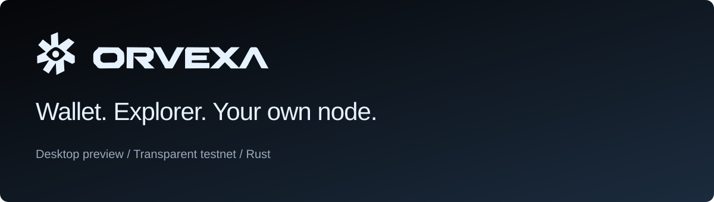
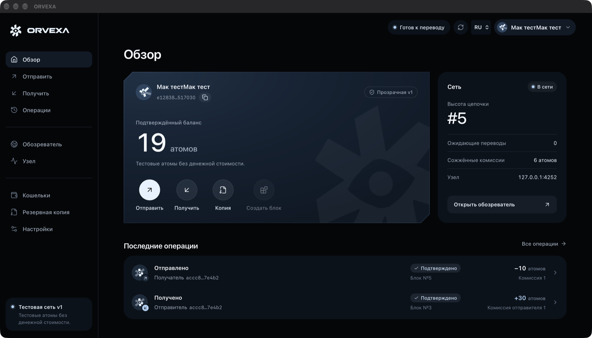

<p align="center"></p>

<p align="center"><a href="https://waxiechc.github.io/orvexa/">Website</a> · <a href="https://github.com/waxiechc/orvexa/releases/tag/v0.1.0-desktop-preview.4">Download Desktop</a> · <a href="docs/DESKTOP_APP.md">Desktop guide</a> · <a href="docs/PLATFORM_PLAN.md">Roadmap</a> · <a href="README.md">Русский</a></p>

ORVEXA is a Rust cryptocurrency research project with a working Windows desktop
app, local wallet, block explorer and native P2P full node.

**Current release: transparent v1 testnet.** Addresses, amounts and sender links
are public. Test atoms have no monetary value. One configured authority creates
blocks; running a full node does not grant validator voting power or rewards.
The public network is not live and no hosted bootstrap is supplied.

The goal is **private payments and balances by default**, optional public
payments and owner-controlled disclosure. This requires a new ledger, not a
cosmetic switch. Read the [privacy design](docs/PRIVACY_DESIGN.md) and
[staged product plan](docs/PLATFORM_PLAN.md). ORVEXA is a provisional name.

## Get the app

[**Download ORVEXA.exe — Windows x64**](https://github.com/waxiechc/orvexa/releases/download/v0.1.0-desktop-preview.4/ORVEXA.exe)

[Complete ZIP + instructions + notices](https://github.com/waxiechc/orvexa/releases/download/v0.1.0-desktop-preview.4/ORVEXA-Desktop-Windows-x64.zip)
· [**ORVEXA for macOS 14+**](https://github.com/waxiechc/orvexa/releases/download/v0.1.0-desktop-preview.4/ORVEXA-macOS-universal.zip) ([how to open](docs/MACOS.md))
· [SHA-256 checksums](https://github.com/waxiechc/orvexa/releases/download/v0.1.0-desktop-preview.4/SHA256SUMS.txt)

1. Open the EXE. Microsoft WebView2 runtime is required; Rust, Node.js, Docker,
   VPN and a cloud account are not needed to run it.
2. Create a local wallet. Save its encrypted backup and password. V1 uses encrypted
   JSON backups; seed phrase recovery is planned, not implemented.
3. To join a common network, import its public `genesis.json` and `network.json`
   on **Node**, independently verify the chain ID, then press **Start node**.
   Obtain actual network files from an operator.
4. Keep the app open. Its node runs in the background while you use Wallet and
   Explorer. Closing this preview stops its node. Resume on app launch is optional.

Data lives in `%LOCALAPPDATA%\ORVEXA`, separately from the EXE. No operator
wallets, peer identities, live genesis or chain databases ship in the app.
See [the desktop guide](docs/DESKTOP_APP.md) for backups, ports and limitations.



## What works

| Component | Delivered |
| --- | --- |
| Wallet | Local Rust/Wasm signing, encrypted keys, send/receive QR, history, native-compatible backup/restore |
| Explorer | Actual blocks, transaction hash lookup, inclusion counts and public v1 address data |
| Desktop | Native Windows window, embedded assets, Start/Stop, verified network import, persisted profile, restart/resume |
| P2P | TCP/Noise/Yamux, separate PeerId, pinned genesis, bounded sync/discovery, conflict quarantine |
| Ledger | Strict Ed25519, nonce/double-spend checks, fixed supply, burned fees, atomic SQLite commit and replay |

Private amounts/balances, selective disclosure, seed wallets, validator quorum,
rewards and a real-money release are **not implemented**. Each has a separate
acceptance gate; none follows automatically from a library or UI label.

## Run a server

Run the headless Rust node on your own machine. Joining needs a reachable peer;
ordinary NAT clients can dial outbound. Independently reachable bootstrap
operators are still needed for a public network.

```bash
git clone https://github.com/waxiechc/orvexa.git
cd orvexa
cargo build --release --locked -p orvexa-node -p orvexa-cli
```

Follow the [Windows/Linux network guide](docs/NATIVE_P2P.md) using the **same**
genesis and chain ID. Separate genesis files create separate networks. Never
give participants the authority wallet. Replicas do not replace an offline authority.

## Build and test

Rust 1.93+ and a C toolchain are needed for bundled SQLite/ring dependencies.
Building the UI needs Node.js 24+ and the pinned Wasm toolchain.

```powershell
cargo fmt --all -- --check
cargo check --workspace --locked
cargo test --workspace --locked
cargo clippy --workspace --all-targets --all-features --locked -- -D warnings
powershell -NoProfile -ExecutionPolicy Bypass -File .\scripts\build-web.ps1 -InstallTools
powershell -NoProfile -ExecutionPolicy Bypass -File .\scripts\package-desktop.ps1
```

Native macOS 14+ support and a universal packaging script are in source; a verified Mac archive is not available yet. See [Mac instructions](docs/MACOS.md). Linux uses the headless node/controller.
Original v1 workflows remain available. Legacy `VOID/...` signing domains and
`void_test_` addresses intentionally preserve v1 compatibility.

Tests include a real **100-node local TCP/Noise exercise**, separate-process
transfer/restart demonstrations, native WebView2/Wasm wallet creation and browser
Wallet/Explorer flows. Local tests do not establish public Internet DoS resistance
or 100 independent operators. See [validation](docs/VALIDATION.md).

## Development direction

1. Desktop and supervised full-node operation.
2. Isolated evaluation of a maintained privacy backend.
3. Confidential ledger, note scanning and mnemonic recovery.
4. Mature BFT engine integration, validator admission and automatic proposer rotation.
5. Specified emission, Sybil resistance and consensus-verified rewards.
6. Volunteer infrastructure, independent audits and release hardening.

A future four-validator equal-weight BFT setup needs three available validators
to commit; two cannot. After all nodes go offline, saved history survives on
retained disks, but production waits for the required signing quorum. Seeds
recover wallet keys, not permanently lost blockchain history.

## References

[Architecture](ARCHITECTURE.md) · [Threat model](THREAT_MODEL.md) ·
[Privacy](PRIVACY.md) · [Product plan](docs/PLATFORM_PLAN.md) ·
[Contributing](CONTRIBUTING.md) · [Security](SECURITY.md)

MIT source license. Upstream notices accompany the release and are embedded
in the desktop app. No independent ORVEXA security audit is claimed.
